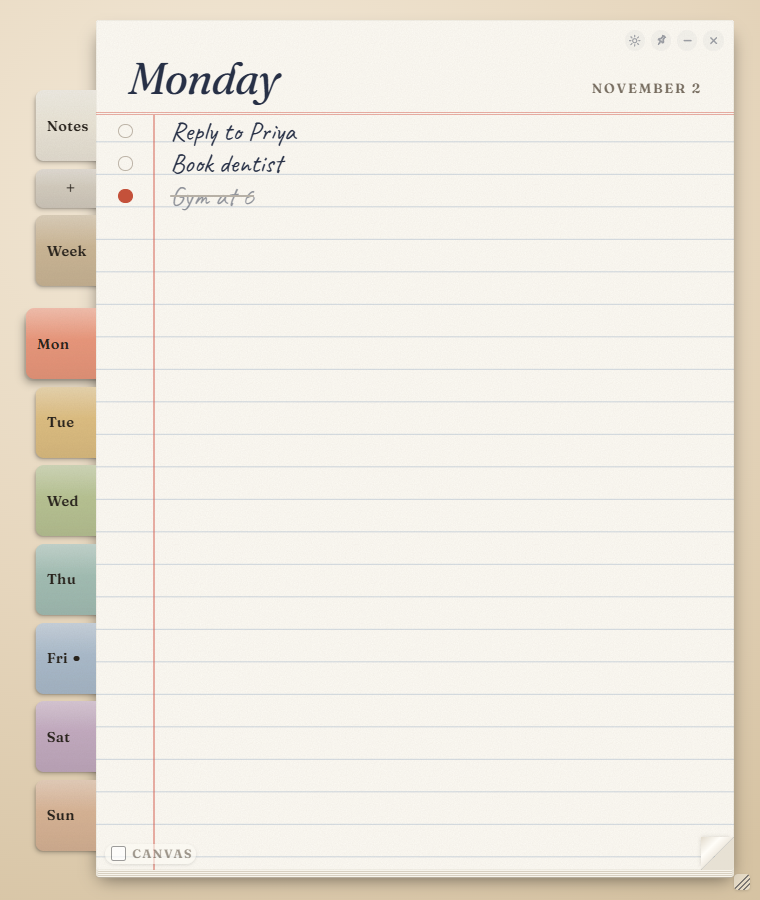
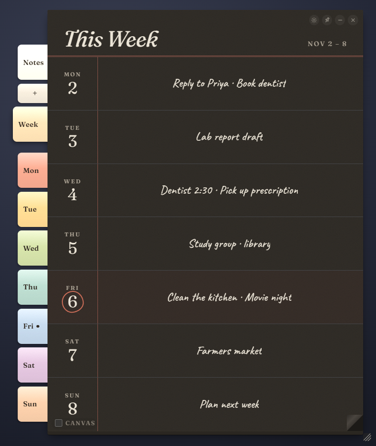

# Notepad

A minimal, lightweight to-do list that sits on your desktop like a paper notepad, with your Canvas assignments on it.

There's no window frame or background: only the pad and its index tabs are drawn, and clicks on the empty space around them go through to whatever is underneath. Pages flip up and over the top. It lives in the system tray, so it's always a click away and never in the way.

<p align="center">
  
  &nbsp;&nbsp;
  
</p>

**Pages**, top to bottom (matching the tabs on the left):

1. **Notes**: as many pages as you like. The **+** tab under Notes adds one; *Rename* (beside the title) names it; *Crumple* balls it up and throws it away. With several pages, the ▾ on the Notes tab collapses them into one tab.
2. **Week**: this week at a glance, Monday to Sunday, with each day's notes and assignments
3. **Mon … Sun**: a ruled page for each day. Today is marked.

Click a tab, or the folded corner at the bottom right of a page, to flip. Everything you write saves automatically.

**Writing**: every line is an item. Click the mark in the margin (or press Ctrl+Enter) to cross a line out; it sinks to the bottom of the page, and clicking again brings it back. Settings offers three looks: cross-out marks, checkboxes, or numbered lines.

## Download

Grab the latest version from the [Releases](../../releases/latest) page. There are two files; you only need one:

- **`Notepad Setup <version>.exe`**: an installer. Adds a Start menu entry and a desktop shortcut, and can be removed from Windows Settings → Apps.
- **`Notepad-<version>-portable.exe`**: a single file that runs without installing. Keep it anywhere.

Both share the same saved pages and settings, so you can switch between them.

> **Windows SmartScreen** will warn you the first time ("Windows protected your PC"), because the app isn't code-signed. Click **More info → Run anyway**. The source is all here if you'd rather build it yourself.

## Canvas assignments

Tick the **Canvas** box at the pad's bottom-left and your Canvas assignments appear on each day's page and in the week overview: due time, course, and a strike-through once submitted. Clicking one opens it in Canvas.

Connecting takes a minute and works with any school's Canvas:

- **Sign in**: type your school's name, pick it from the list, and your school's normal Canvas sign-in page opens, SSO included. The notepad keeps the signed-in session. Sessions expire after a while, so you'll occasionally be asked to sign in again.
- **Access token** (no re-signing-in): in Canvas go to *Account → Settings → Approved Integrations → + New Access Token*, leave the expiry blank, and paste the token into the Canvas card. It's stored encrypted on your computer.

Assignments refresh every 30 minutes and are cached, so the last update stays visible offline. The Canvas card (Settings → Canvas assignments) lets you hide individual courses.

Your password never passes through the notepad: it's typed into Canvas's own page, in a window the notepad only watches for "signed in." Nothing is sent anywhere except to your school's Canvas server.

## Using it

- **Move it**: drag the page's title or the strip above it, or drag the tabs and week rows.
- **Resize it**: drag the small grip just off the pad's bottom-right corner. It keeps its proportions.
- **Pin** (top right): locks it in place (no moving or resizing) and keeps it in front. Click again to unpin.
- **Settings** (gear, top right): Light / Dark / System appearance, writing font (Handwritten, Serif, Sans, Mono), text size, list style, *Keep in front of other apps* (stays in front even when unpinned), and the Canvas card.
- **–** minimizes to the taskbar. **×** tucks it into the tray (the hidden icons by the clock); click the tray icon to bring it back.
- **Right-click the tray icon** for *Pin in place*, *Start with Windows*, and *Quit*.

## Build it yourself

Needs [Node.js](https://nodejs.org) 20 or newer.

```bash
npm install
npm start
```

To make the installer and portable exe (written to `dist/`):

```bash
npm run dist
```

## Releasing

Releases are built by GitHub Actions. Bump `version` in `package.json`, commit, then tag and push:

```bash
git tag v0.1.0
```

```bash
git push origin main --tags
```

The workflow builds both exes on a Windows runner and publishes a release with them attached.

## Files

| File | What it is |
| --- | --- |
| `index.html`, `styles.css`, `app.js` | The notepad itself |
| `main.js` | Electron desktop shell: transparent window, tray icon, pinning, native drag |
| `preload.js` | The few window actions the page may ask for |
| `canvas.js` | Canvas integration: school finder, sign-in window, access token, fetching and caching |
| `scripts/make-icons.js` | Draws the app/tray icon into `assets/` (`npm run icons`) |
| `scripts/screenshots.js` | Renders the README screenshots into `docs/` (`npm run screenshots`) |
| `.github/workflows/release.yml` | Builds and publishes a release on each `v*` tag |
